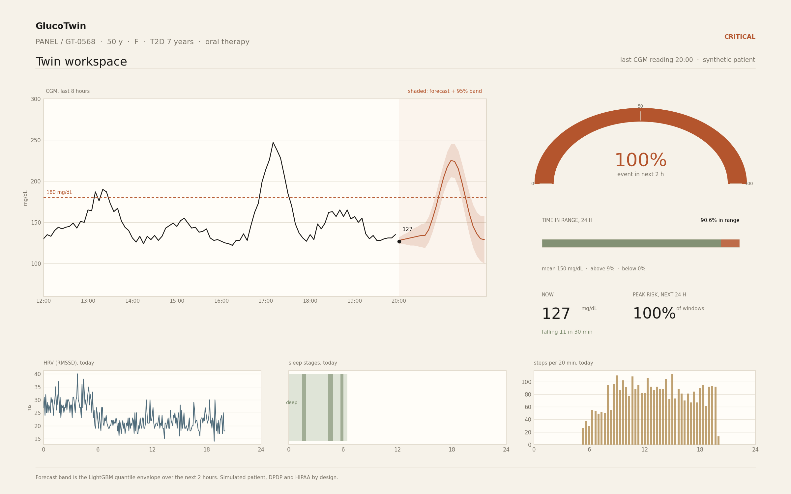
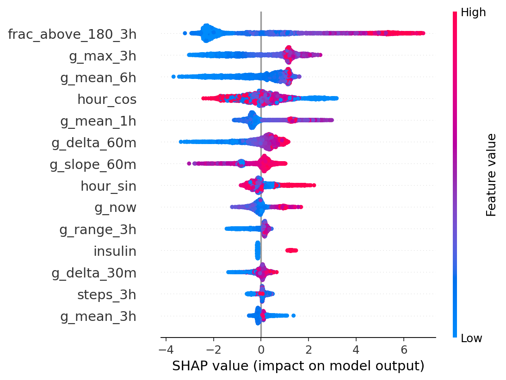
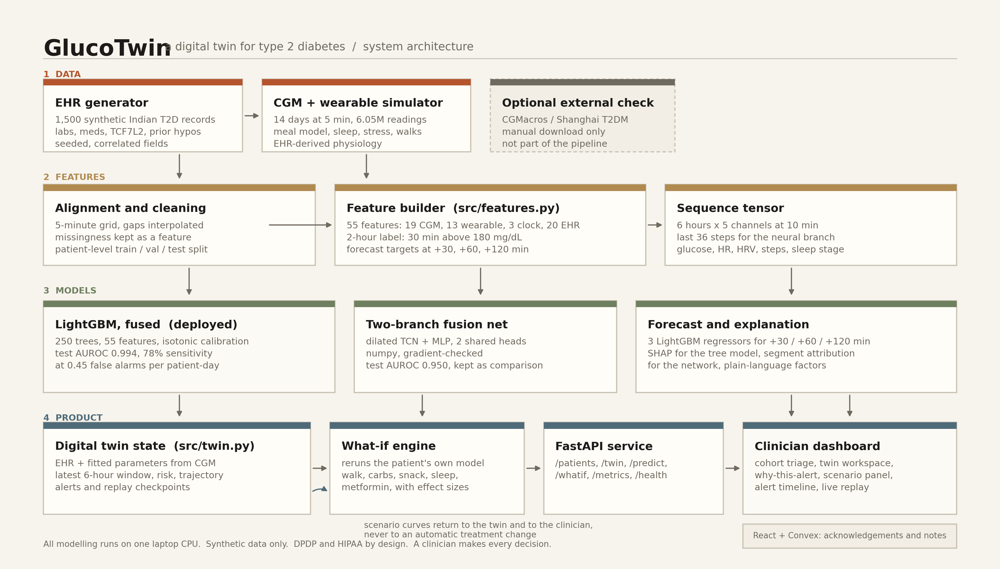
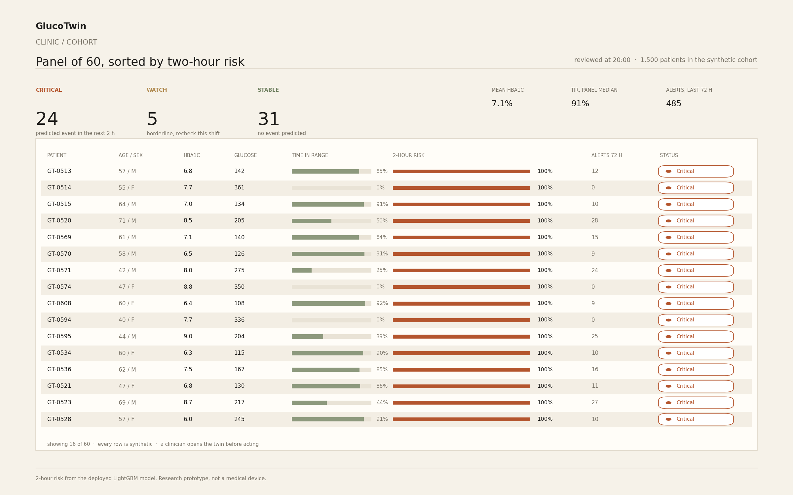
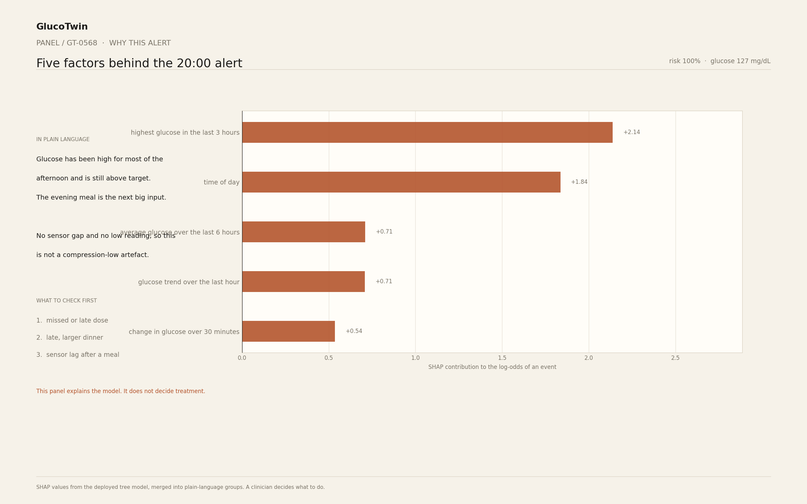
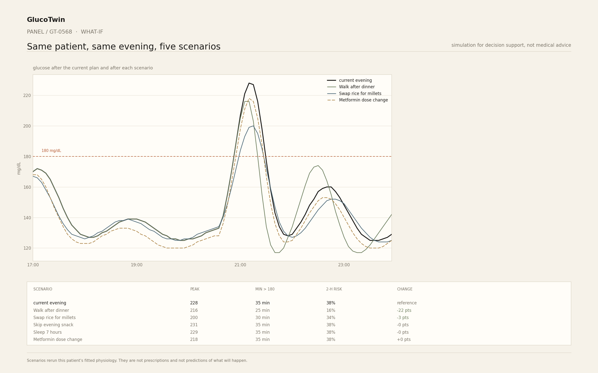
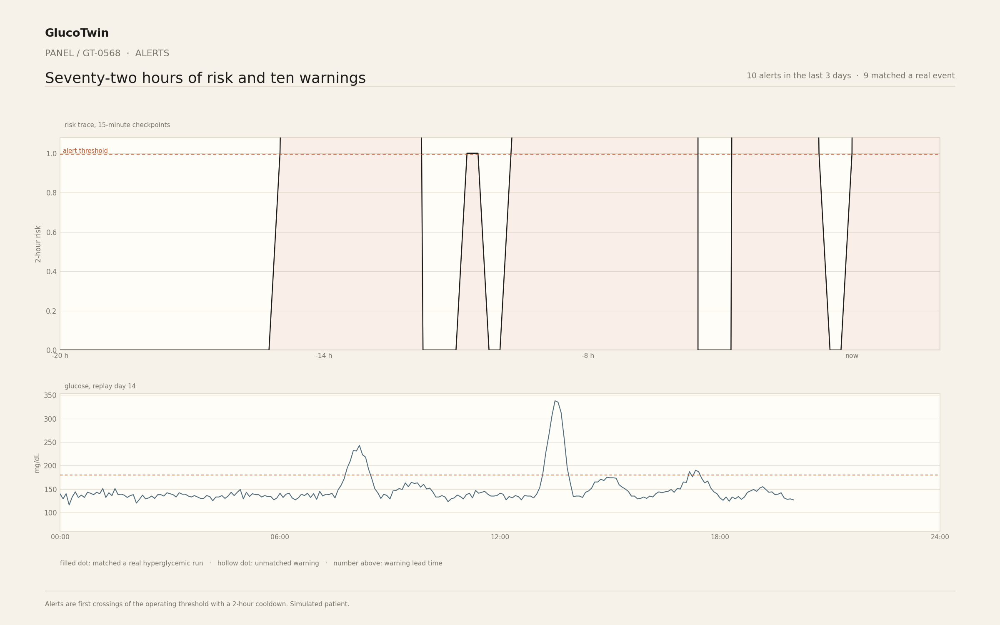

# GlucoTwin

A digital twin for type 2 diabetes that fuses a patient record with two weeks of
CGM and wearable data, predicts a hyperglycemic event two hours before it
happens, and lets a clinician test "what if" scenarios on that patient's own
physiology.

Built for the Happiest Health "Reimagining and Reforming Healthcare in India"
Summit 2026 challenge. Everything here is a research prototype on synthetic
data. It is not a medical device and it does not give medical advice.



## Team details and college / incubator

- Team: [TEAM NAME]
- [MEMBER 1, ROLE, EMAIL]
- [MEMBER 2, ROLE, EMAIL]
- [MEMBER 3, ROLE, EMAIL]
- College: [COLLEGE]
- Incubator: [INCUBATOR]
- Mentor: [MENTOR NAME, ROLE]

Replace the placeholders before submitting. No real institution is implied.

## Project title

**GlucoTwin: a two-hour warning and a what-if sandbox for type 2 diabetes.**

One sentence: we rebuild a patient as a virtual replica, watch the replica's
last six hours, warn the clinic when the next two hours are likely to cross
180 mg/dL, and show what a walk, a smaller dinner or a dose review would do to
that same replica.

## Problem statement and healthcare use case

India carries a very large diabetes burden. The ICMR-INDIAB study published in
2023 estimated 101 million people with diabetes and 136 million with
prediabetes in India [CITE]. Most care happens in short clinic visits separated
by months, while the disease acts every day.

Three things follow from that gap:

1. **Hyperglycemia is mostly silent.** A patient can spend hours above 180
   mg/dL without feeling it, and only see the damage in the next HbA1c test.
2. **The clinic sees a snapshot, not a life.** A fasting glucose at 09:00 says
   little about what happens after the 21:00 dinner, which is often the worst
   window of the day.
3. **Advice is generic because the data is generic.** "Walk after dinner" helps
   one patient and barely moves another. A clinician has no cheap way to check
   which is which before saying it.

GlucoTwin addresses those three points with one artefact per patient:

- a **twin state** that combines the static record (labs, medications, genotype)
  with the dynamic stream (CGM, heart rate, HRV, steps, sleep),
- a **two-hour event probability** for "glucose above 180 mg/dL for at least 30
  minutes", with an uncertainty band and a lead time,
- a **what-if engine** that reruns the same patient's fitted physiology under a
  behavioural or medication change, so the conversation in the clinic is about
  this patient, not about diabetes in general.

The intended user is a doctor, nurse or diabetes educator in an outpatient
clinic. The output is decision support. A clinician makes every decision.

### What a clinician actually does with it

1. Open the cohort view in the morning. It is sorted by two-hour risk, with a
   status chip for every patient.
2. Open the highest-risk twin. Read the last six hours, the forecast band, time
   in range and the wearable panel.
3. Read "Why this alert". It lists the top five SHAP factors in plain language.
4. Try a scenario. If a 30 minute walk after dinner cuts the predicted peak by
   12 mg/dL and halves the event probability, that is a concrete thing to
   suggest. If it does nothing, the clinician knows not to spend the
   conversation there.
5. Acknowledge the alert and leave a note. Both are stored per clinician.

## Technical stack and AI/ML model details

### Stack

| Layer | What is used |
| --- | --- |
| Data generation | Python 3.10, numpy, pandas |
| Features and labels | numpy (rolling windows, slopes, gap interpolation) |
| Tree models | LightGBM 4.7, scikit-learn (isotonic calibration, metrics) |
| Fusion network | numpy only, manual backprop, gradient-checked in tests |
| Explanations | SHAP TreeExplainer for the deployed model, segment attribution for the network |
| Reference API | FastAPI + uvicorn |
| Clinical dashboard | React 19, TypeScript, Vite, Tailwind v4, shadcn/ui, Recharts, Convex, Convex Auth |
| Documents | matplotlib (architecture, plots, screenshot plates), python-pptx (slides) |
| Tests | pytest |

`torch` is not installed. The two-branch network is a real network with a
dilated temporal convolutional branch and an MLP branch, written in numpy so it
trains on one CPU core in this sandbox. The reason is in
[docs/DECISIONS.md](docs/DECISIONS.md). LightGBM won the comparison anyway, so
the deployed model is the tree model, as the brief requires when the neural
model does not beat it.

The Streamlit dashboard in the original brief is replaced by the React clinic
workspace in this repository, because the submission runs as a web app in this
environment and Streamlit cannot be previewed or verified here. The FastAPI
service is kept. This is documented in DECISIONS as well.

### Data

1,500 synthetic Indian T2D patients, 14 days each, 5-minute resolution, 6.05
million glucose readings. The EHR and CGM streams are linked: basal glucose,
insulin sensitivity, glucose time constant and secretion gain are all functions
of that patient's record, so a patient with a high fasting glucose, a long
duration and a TT genotype at TCF7L2 really does have a different curve.

Every distribution assumption, and the known gaps, are listed in
[docs/DATA_CARD.md](docs/DATA_CARD.md). The short version:

- earlier onset and lower BMI than Western cohorts, with higher central
  adiposity at the same BMI,
- rice and roti based meals, chai-time snacks, a festival day with 45% more
  carbohydrate,
- sleep that changes next-day insulin sensitivity, post-meal walks that raise it
  for about two hours, stress that lifts glucose,
- sensor noise, drift and dropouts (1.5% missing).

### Label

At each 5-minute checkpoint, the label is 1 if glucose stays above 180 mg/dL for
at least 30 consecutive minutes at any point in the next 120 minutes. The test
cohort base rate is 41.1%. It is high because the synthetic cohort is
deliberately uncontrolled; a real primary-care panel would be lower and harder.

### Models compared

| Model | Input | Purpose |
| --- | --- | --- |
| Persistence | current glucose above 180 | baseline |
| LightGBM CGM-only | 15 CGM features | how far the sensor alone gets |
| LightGBM EHR-only | 20 static record fields | how far the record alone gets |
| LightGBM fused | all 55 features | **deployed** |
| Fusion network | 6 h x 5 channels + 20 static fields | the main model from the brief |

The 55 features are 19 CGM, 13 wearable, 3 clock and 20 EHR. LightGBM uses 250
trees, learning rate 0.06, 31 leaves, `scale_pos_weight` for the class
imbalance. Probabilities are calibrated with isotonic regression fitted on the
validation patients. The operating threshold is chosen on validation to keep
false alarms at or below 0.5 per patient-day, then frozen for the test set.

The fusion network has a causal dilated TCN (5 layers, 16 channels, kernel 3)
over the last six hours at 10-minute resolution and a 32-unit MLP over the
static record, joined into a shared head with one event output and three
forecast outputs. It trains with Adam for 2 epochs on a fixed budget.

The split is by patient, 900 / 300 / 300, so no patient appears in two splits.

## Results

All numbers below are written by `src/evaluate.py` into `results/metrics.json`
and `results/ablation.csv`. They are measured on 300 test patients that were
never seen in training or threshold selection.

### Event prediction, same 30-minute checkpoint cadence for every model

| Model | AUROC | AUPRC | Within-patient AUROC | Brier | Sensitivity at 0.5 FA/day | Mean lead |
| --- | --- | --- | --- | --- | --- | --- |
| Persistence | 0.7972 | 0.7984 | 0.6213 | 0.1889 | 6.4% | 47.6 min |
| LightGBM, CGM only | 0.9837 | 0.9797 | 0.9683 | 0.0460 | 70.4% | 50.2 min |
| LightGBM, EHR only | 0.7906 | 0.7635 | 0.5000 | 0.1732 | 4.5% | 50.2 min |
| **LightGBM, fused** | **0.9941** | **0.9921** | **0.9882** | **0.0283** | **77.9%** | **53.5 min** |
| Fusion network | 0.9496 | 0.9333 | 0.9159 | 0.0885 | 24.2% | 47.2 min |

The deployed model on the denser 15-minute timeline: AUROC 0.9940, AUPRC
0.9920, Brier 0.0284, sensitivity 81.2% at 0.62 false alarms per patient-day,
mean lead 59.8 minutes, median lead 60 minutes.

### Glucose forecasting (LightGBM regressors)

| Horizon | RMSE | MAE |
| --- | --- | --- |
| +30 min | 11.0 mg/dL | 7.5 mg/dL |
| +60 min | 13.9 mg/dL | 9.1 mg/dL |
| +120 min | 23.4 mg/dL | 15.2 mg/dL |

### What the model looks at

Top mean absolute SHAP values on the test set: fraction of the last 3 hours
above 180 (2.24), maximum glucose in 3 hours (1.28), 6-hour mean glucose (0.93),
hour of day (0.75), 1-hour mean glucose (0.61), 60-minute glucose change (0.54).
Static EHR fields have small SHAP values because they explain who is at risk,
not when the next event happens. That is also why the EHR-only model has a
within-patient AUROC of exactly 0.5: a constant vector cannot rank two moments
in the same patient's day.



### Honest failures

- **The neural model lost.** AUROC 0.9496 against 0.9941 for LightGBM. It is
  kept, documented and shown in the ablation, but it is not deployed.
- **The alarm rate is high.** At the operating point the model raises about 2.5
  alarms per patient-day. Fine for a demo, too noisy for a ward without a higher
  threshold.
- **Catastrophic misses exist.** The cohort includes patients who spend most of
  the day above 300 mg/dL. For them a 30 minute run above 180 is not a
  prediction problem, it is the baseline, and the operating threshold suppresses
  alerts. Those patients need a different clinical pathway, not a better model.
- **The what-if engine is a simulation.** It uses the patient's fitted
  parameters and the same meal model, so the direction of an effect is more
  trustworthy than its exact size.

### Twin parameter recovery

The twin fits insulin sensitivity and basal glucose from the CGM signal through
a ridge model trained on 400 patients and checked on 150 held-out patients. On
those 150, `s_i` recovery has R2 0.82, median absolute percentage error 8.4% and
Spearman correlation 0.91 against the simulator's true values. This proves the
fitting procedure works when the answer is known. It says nothing about real
patients.

## How to run

Python 3.10 or newer. One CPU core is enough, and the full pipeline was built
and run on one.

### 1. Install

```bash
python3 -m venv .venv
source .venv/bin/activate
pip install -r requirements.txt
```

### 2. One command per stage

```bash
make data      # ehr_gen.py, cgm_sim.py, make_sample.py
make train     # LightGBM event models, forecasters, fusion network
make eval      # test metrics, ablation, plots, SHAP
make export    # JSON bundle for the dashboard
make test      # pytest
```

Or without make:

```bash
python src/ehr_gen.py
python src/cgm_sim.py
python src/make_sample.py
python src/train.py --trees
python src/train.py --forecast
python src/train.py --net
python src/evaluate.py
python src/export_web.py
python -m pytest -q
```

Everything is seeded (seed 42). Re-running reproduces the same files on the
pinned versions.

### 3. The API

```bash
make api
# in another shell
curl localhost:8000/patients | head
curl localhost:8000/patients/GT-0568/twin | head
curl -X POST localhost:8000/predict -H 'content-type: application/json' \
  -d '{"patient_id":"GT-0568"}'
curl -X POST localhost:8000/whatif -H 'content-type: application/json' \
  -d '{"patient_id":"GT-0568","scenario":"walk_after_dinner"}'
```

Interactive docs are at `http://localhost:8000/docs`.

### 4. The clinic dashboard

```bash
bun install
bunx convex dev     # terminal 1, creates the local Convex deployment
bun run dev         # terminal 2, Vite
```

Open `/`, then "Open the clinic". `/dashboard` is protected by the template's
auth wrapper and sends signed-out visitors to `/auth` with a return path. In the
hosted Freebuff environment both processes are already managed, so only the
preview link is needed.

### 5. Documents

```bash
make docs      # architecture.pdf/png, presentation.pptx/pdf, screenshots
```

### Optional: score the model on real data

This is the only part of the repository that touches real data, and it is
optional. Download an openly licensed CGM dataset yourself (CGMacros on
PhysioNet, or the Shanghai T2DM dataset), keep it out of git, then:

```bash
python src/validate_external.py --input /path/to/cgm.csv \
  --name CGMacros --out results/external_validation.json
```

The input is a long CSV with `patient_id,timestamp,glucose` (column names are
auto-detected, mmol/L is converted). It reports AUROC, AUPRC, Brier and
sensitivity at 10% FPR for the CGM-only model. **This has not been run in this
submission.** The data is not bundled and no external performance is claimed.

## Demo video link

[DEMO VIDEO LINK, minimum 20 minutes]

A 22-minute shot-by-shot script with slide numbers, click targets and a
two-minute recording checklist is in
[docs/VIDEO_SCRIPT.md](docs/VIDEO_SCRIPT.md). The recording covers the problem,
the data, the model, the twin, the what-if engine, the dashboard, the honest
failures and the roadmap.

## Open-source license details

MIT. See [LICENSE](LICENSE).

- Code: MIT, free to use, modify and redistribute with attribution.
- Data: synthetic, generated by this repository, released under the same MIT
  terms. There is no real patient data in this repository, so there is no
  patient consent to clear.
- Third-party libraries keep their own licenses (LightGBM MIT, scikit-learn BSD,
  SHAP MIT, FastAPI MIT, React MIT, Convex Apache 2.0).

## Architecture diagram

[PNG](docs/architecture.png) and [PDF](docs/architecture.pdf).

The flow is: two synthetic data sources, a 5-minute alignment and feature
builder, a fused tree model (with the TCN fusion network as the comparison), the
twin state, the what-if engine, the API and the clinician dashboard. The
optional external validation sits off to the side and nothing in the main
pipeline depends on it.



## Presentation

- [docs/presentation.pptx](docs/presentation.pptx)
- [docs/presentation.pdf](docs/presentation.pdf)

Twenty slides: problem, why India, solution, synthetic data, architecture,
model, real results with the ablation, twin, what-if, dashboard, limitations,
roadmap. Plain white slides, black text, large type, one idea per page.

### Dashboard images

These five plates are rendered by `src/make_screenshots.py` from the same JSON
the React app reads. The sandbox has no browser binary, so they are not browser
screenshots; every number, curve and label comes from the exported model
outputs, not from a mockup.

| Cohort triage | Twin workspace |
| --- | --- |
|  |  |

| Why this alert | What-if |
| --- | --- |
|  |  |



## Limitations and ethics

**Data and evidence**

- All results are on synthetic data from our own generator. The model may be
  learning simulator regularities that real CGM data does not share. No
  clinical accuracy is claimed.
- External validation is prepared but not run. Real-world performance is
  unknown.
- The cohort over-represents uncontrolled diabetes (41% positive windows, mean
  glucose 167 mg/dL) and under-represents kidney disease, SGLT2 and GLP-1 use,
  and patients over 79.
- Subgroup fairness was not evaluated. Sex, age band, diet and genotype
  subgroups need equal sensitivity and calibration checks before any clinical
  use.

**Clinical safety**

- The model predicts a glucose pattern, not a cause. It cannot tell a missed
  dose from a festival meal from a faulty sensor.
- The what-if engine is a simulation with the patient's fitted parameters. It is
  labelled as such in the UI and it must not be read as a prescription.
- A missed alert is not evidence that nothing will happen. The UI says this.
- Alerts are deliberately capped at roughly 0.5 false alarms per patient-day in
  development, but the deployed dense threshold produces about 2.7 per day. A
  real ward needs a local alert budget.

**Privacy and regulation**

- No real patient data was used, stored or transmitted. Development is
  synthetic-only by design.
- India's Digital Personal Data Protection Act, 2023 and HIPAA in the US both
  treat CGM and wearable streams as personal health data. A production version
  would need consent, purpose limitation, audit logs, breach notification, data
  principal rights and a data-fiduciary agreement. The design keeps those
  requirements in view: local processing, no third-party transmission, and a
  clear separation between the read-only model outputs and per-clinician
  acknowledgement state.
- This is not a CE-marked or CDSCO-approved device. It is a proof of concept for
  a summit.

**Interface**

- The dashboard screenshots in this repository are rendered from exported JSON,
  not captured from a browser. The live React app is the reference UI.
- The Streamlit screen from the original brief is not included. The React
  workspace replaces it for the reasons in DECISIONS.

## Future work

1. **Prospective validation.** Run the twin for 8 to 12 weeks in one clinic with
   consenting patients, with the alert threshold frozen in advance. Report
   sensitivity, false alarms per patient-week and clinician acceptance, not just
   AUROC.
2. **Real device and health-record integrations.** Apple Health and Google Fit
   for steps, sleep and heart rate; ABDM / ABHA for records; CGM vendor APIs
   (Dexcom, Libre) for 5-minute glucose. The API already has the shape for it.
3. **Federated learning.** Train across clinics without moving records. The
   static branch and the tree model can be federated with modest changes; the
   evaluation harness already splits by patient.
4. **A fairer cohort.** Add CKD stages, SGLT2 and GLP-1 therapy, and a
   well-controlled arm, then re-check calibration and subgroup sensitivity.
5. **Better counterfactuals.** Replace the hand-set effect sizes in the what-if
   engine with effects estimated from a randomised or quasi-experimental cohort.
6. **A closed feedback loop.** Log which alerts clinicians accept, which
   scenarios they use, and what actually happened, then recalibrate per site.
7. **Model improvements that are worth trying.** A monotone constraint on recent
   time above range, a survival formulation for time-to-event instead of a fixed
   2-hour window, and conformal prediction for the forecast band.
